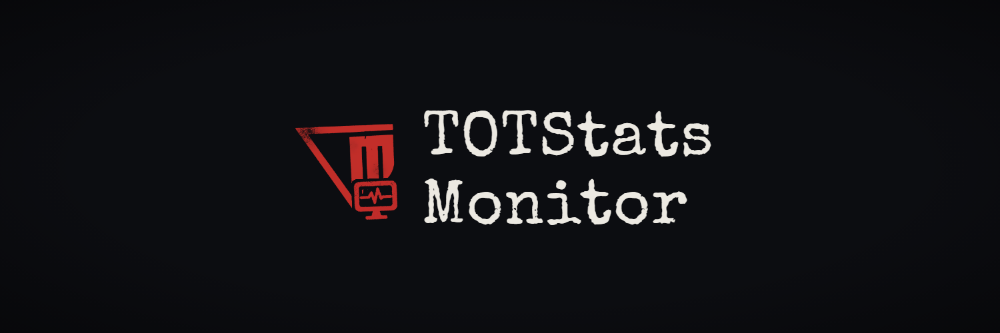

<p align="center">
  
</p>


A small companion app for [outlasttrialsstats.com](https://outlasttrialsstats.com). It sits in
your Windows system tray, watches The Outlast Trials' own log file while you play, and turns that
into two things: Discord Rich Presence, and community statistics.

It reads a log file the game already writes. It does not touch the game, its memory, or its
files, and it needs no launch options.

## Quick Start

**No Python installation required.**

### Windows

[](https://github.com/OutlastTrialsStats/totstats-monitor/releases/latest/download/TOTStatsMonitor-Setup.exe)

1. Download and run the installer. It needs no administrator rights.
2. Keep **Start TOTStatsMonitor when I sign in to Windows** ticked if you want it running the next
   time you play. Untick it and the app never starts on its own.
3. Finish, and the app starts in the system tray.

The installer is not signed, so Windows SmartScreen will warn you the first time. Click "More
info", then "Run anyway". Running the installer again updates the app in place.

### Linux

Download `TOTStatsMonitor-linux-x86_64` from the
[latest release](https://github.com/OutlastTrialsStats/totstats-monitor/releases/latest), make it
executable and run it:

```sh
chmod +x TOTStatsMonitor-linux-x86_64
./TOTStatsMonitor-linux-x86_64
```

On the first start it asks once whether to launch at login. The app finds the game's log inside
the Steam Proton prefix on its own, in the default Steam folder and in any extra library listed
in Steam. If your Steam lives somewhere unusual, point it there with `--logs-dir`.

The tray icon needs a desktop that shows tray icons. On GNOME that means the AppIndicator
extension. Without one the app still works, and **Console** opens from the first start instead.
The Discord desktop app must be running; the Flatpak and Snap builds of Discord are not
supported yet.

## Features

### Discord Rich Presence

Shows what you are currently playing on your Discord profile: which trial, where it takes place,
which difficulty, how full the party is, and how long you have been in there. The trial artwork
comes along with it, and a button that links to your stats page. Escalation shows which step you
are on, Invasion whether you are the Imposter or a Reagent. Outside a trial it says so too: main
menu, Sleep Room, looking for a group.

<p align="center">
  
  
</p>

It only ever shows something while the game is running, and it needs the Discord desktop app open.
Untick **Discord Rich Presence** in the tray menu and your status is cleared immediately.

### Contribute player data

While you are in a match, the app picks up the profile IDs of the players you meet and sends them
to outlasttrialsstats.com. That is how new players get discovered and added to the community
statistics database — the site can only track players it already knows about.

All contributors automatically receive an exclusive contributor badge on their profile at
outlasttrialsstats.com.

Only profile IDs are sent, theirs and yours as the contributor. No names, no chat, nothing about
your own performance. You can watch exactly what happens in the Console window, and switch the
whole thing off from the tray menu without uninstalling.

## System Tray

The app runs in the background and shows an icon in the system tray (on Windows bottom-right, behind
the `^` arrow). Right-click it for the menu:

| Option | Description |
|---|---|
| **Status** | Whether it is monitoring, waiting for the game, or paused |
| **Contribute player data** | Turns contributing on or off immediately, without uninstalling |
| **Discord Rich Presence** | Shows or hides what you are playing on your Discord profile |
| **Customize Discord status…** | Picks what your Discord status shows and lets you write your own text for it |
| **Start with Windows** (**Start at login** on Linux) | Adds or removes the autostart entry |
| **Language** | Switches the app's language; **System default** follows your system language |
| **Console** | A live log window: detected players, API responses, errors |
| **Uninstall** | Shuts down and starts the uninstaller (Linux: deletes the data folder, you delete the file) |
| **Exit** | Stops the app without uninstalling |

Everything the app keeps lives in `%LOCALAPPDATA%\TOTStatsMonitor\`: `settings.json`, its own
`monitor.log`, and the cached trial list. Uninstall deletes that folder and the autostart entry
and leaves nothing else behind.

## Languages

The app comes in English, German, French and Spanish and picks your system language by default.
To choose another one, open **Language** in the tray menu.

Translations are plain JSON files, one per language. To add or improve one for everybody, put it in
`locales/<code>.json` in this repository and open a pull request (see
[CONTRIBUTING.md](doc/CONTRIBUTING.md#adding-a-translation)). For yourself only, drop the file into the
`locales` folder in the app's data folder — `%LOCALAPPDATA%\TOTStatsMonitor\locales\` on Windows,
`~/.local/share/TOTStatsMonitor/locales/` on Linux. A file there with the same code as a built-in
language overrides only the texts it contains. Anything missing from a translation is shown in
English.

## Contributing

Pull requests are welcome. See [CONTRIBUTING.md](doc/CONTRIBUTING.md) for the development setup, and
[doc/commit-convention.md](doc/commit-convention.md) for the commit message format — commit
messages drive the version bump and the changelog through `release-please`.

## License

[GPL-3.0](LICENSE)

## Disclaimer

We are not Red Barrels and not partnered with Red Barrels or The Outlast Trials.
